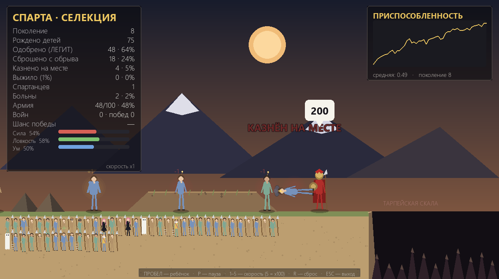
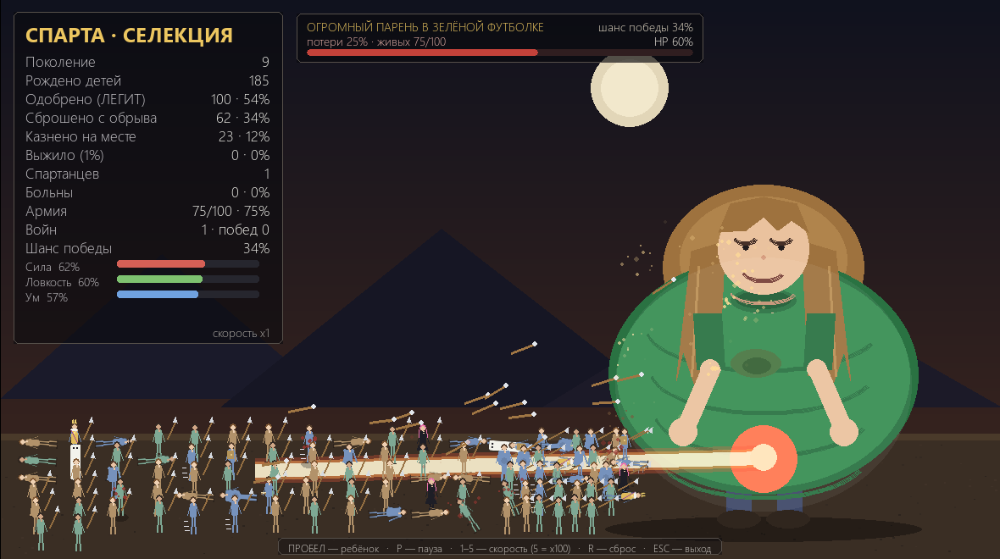

# Спарта: селекция

2D-симуляция на `pygame`: спартанцы проверяют детей на «ЛЕГИТ», а характеристики
популяции подбираются дарвиновским отбором.





## Запуск

```powershell
pip install pygame
python sparta_evolution.py
```

Нужен Python 3.10+.

## Правила мира

* Каждый ребёнок получает случайный набор модификаций — положительных и отрицательных.
* Спартанец-инспектор проверяет ребёнка. Есть хотя бы одна отрицательная модификация —
  приговор «НЕ ЛЕГИТ», ребёнка ведут к обрыву и сбрасывают с Тарпейской скалы.
* Шанс выжить при падении — **1%**. Выживший вступает в ряды спартанцев.
* С шансом **5%** спартанец вместо приговора говорит **«200»** — и ребёнок умирает
  на том же месте, каким бы ни был набор модификаций.
* Одобренные дети встают в строй: **100 легитимных бойцов** выстраиваются в три ряда,
  а затем всё войско уходит на войну, и набор в армию начинается заново.
* Одобренные дети попадают в пул генов. Новые дети рождаются от двух родителей,
  выбранных с вероятностью, пропорциональной их приспособленности
  (`0.40·Сила + 0.35·Ловкость + 0.25·Ум`), плюс немного мутационного шума.
* Отрицательные модификации вычищаются отбором, положительные накапливаются,
  поэтому средние характеристики растут от поколения к поколению —
  это видно на графике приспособленности.
* **Болезни** временно ухудшают характеристики: ребёнок может подхватить простуду,
  лихорадку, дизентерию или чуму (20% при рождении) либо унаследовать болезнь
  от больного родителя (40%). Болезнь длится 20–35 секунд симуляции, затем проходит.
  Больной ген получает пониженную приспособленность, поэтому реже становится родителем
  и может выпасть при сокращении пула — так отбор всё равно выбирает сильнейших.

## Болезни

| Болезнь | Длительность | Что происходит |
| --- | --- | --- |
| Простуда | 35 с | Сила −10%, ловкость −18%, ум −5% |
| Лихорадка | 26 с | Сила −25%, ловкость −20%, ум −30% |
| Дизентерия | 30 с | Сила −34%, ловкость −28%, ум −10% |
| Чума | 20 с | Сила, ловкость и ум −40…45% |

Больные дети помечены зелёным крестиком, иногда «апчхи!». В HUD есть строка
**«Больны»** с долей больных от популяции.

## Судьбы детей

| Судьба | Когда срабатывает |
| --- | --- |
| `ЛЕГИТ` | нет ни одной отрицательной модификации |
| `НЕ ЛЕГИТ` | есть отрицательная модификация |
| «200» | 5% приговоров, смерть на месте |
| Метеорит | модификация **Васильев** |
| Взрыв | модификация **ИГОРЬ К.** |

## Война с боссом

Когда в строю набирается **100** легитимных бойцов, войско уходит на войну
и начинается сражение с боссом — **огромным жирным парнем в зелёной футболке**.
У него длинные волосы как у принца, скинни-джинсы и такой живот, что своих ног
он не видит (иногда он так и говорит: «ГДЕ МОИ НОГИ?»).

* **Шанс победы** считается по характеристикам бойцов:
  `0.40·Сила + 0.35·Ловкость + 0.25·Ум` в среднем по армии,
  затем сжимается в диапазон **3–80%**. Он виден в HUD и над полосой HP босса.
  Болезни бойцов учитываются по их текущим, ослабленным характеристикам.
* Часть армии (**62%**) стоит вдали и **кидает копья**, остальные (**38%**)
  сражаются вблизи, тыча копьями в живот.
* Бойцы погибают: падают, остаются лежать на поле, летят искры и пыль.
* Босс атакует примерно раз в секунду, а к концу боя звереет и бьёт чаще.
  Атаки выбираются по весам:
  * **удар лапой** (34%) — убивает 1–2 бойцов;
  * **топот** (19%) — по земле расходятся две ударные волны, гибнут 3–4 бойца,
    экран трясётся;
  * **плевок** (18%) — три зелёных плевка летят по дуге в бойцов;
  * **вертушка** (13%) — босс раскручивается и разбрасывает ближний бой;
  * **лазер из пупка** (10%) — выкашивает трёх бойцов;
  * **бургер** (6%) — лечится на 8% здоровья.
* Над полосой HP показаны проценты здоровья босса и потерь армии.
* Итог боя — **ПОБЕДА** (босс падает и взрывается) или **ПОРАЖЕНИЕ**
  (армия полностью погибает). После этого лагерь продолжает жить,
  а счётчики «Войн» и «побед» растут.

## Внешний вид модификаций

Каждая модификация меняет спрайт ребёнка:

* **КРАСТИН** — очень толстый, с большим животом.
* **АЛЬТУХА С 3 РАЗМЕРОМ** — чёрная одежда и розовые хвостики.
* **НЕ ИЗ СНК** — богатый золотой наряд, корона и меховая накидка.
* **НОСИТ КОСТЮМ «ПРИВЕДЕНИЯ»** — белая простыня с прорезями для глаз.
* **РАБ РЫГАЧЁВА** — без одежды, в рабском ошейнике с заклёпками и цепочкой.
* **Васильев** — над головой грозовая туча, а на самого ребёнка падает метеорит.
* **ИГОРЬ К.** — фитиль на макушке: ребёнок взрывается.
* **Геркулесова сила**, **Широкие плечи** — мускулистый торс.
* **Железная выдержка** — нагрудная броня.
* **Быстрые ноги**, **Лёгкие кости** — линии скорости за спиной.
* **Кошачья реакция** — кошачьи ушки.
* **Острый ум** — очки.
* **Стратегический склад ума** — свиток с планом.
* **Слабые мышцы** — худое тело с рёбрами.
* **Хрупкие кости** — бинты на руке и ноге.
* **Болезненность** — зеленоватая кожа.
* **Хромота** — костыль.
* **Медлительность** — улитка у ног.
* **Дрожащие руки** — ребёнка трясёт.
* **Тугоумие** — красный колпак двоечника.
* **Рассеянность** — точки «витает в облаках».
* **Игрок на спектре** — наушники.
* **Не задонатил** — кружка для пожертвований.
* **ДС-ССА** — тёмный капюшон.
* **Из китай города** — соломенная шляпа.

## Управление

| Клавиша | Действие |
| --- | --- |
| `SPACE` | создать ребёнка вручную |
| `1`–`5` | скорость симуляции (x1, x2, x3, x5, x100) |
| `P` | пауза |
| `R` | сброс |
| `ESC` | выход |

## Что показывает интерфейс

* **Поколение** — максимальное поколение среди рождённых детей.
* **Рождено / Одобрено / Сброшено** — счётчики за текущий прогон; рядом с каждым
  показана доля от всех рождённых детей в процентах.
* **Казнено на месте** — сколько детей погибло от приговора «200» (и от метеорита/взрыва),
  с долей от всех рождённых.
* **Выжило (1%)** и **Спартанцев** — судьба сброшенных детей.
* **Больны** — сколько детей и бойцов сейчас болеют, и их доля от популяции.
* **Армия** — сколько бойцов уже стоит в строю (до 100) и процент заполнения строя;
  во время боя показывает живых бойцов.
* **Войн** — сколько армий ушло на войну, и сколько из них победило.
* **Шанс победы** — вероятность победы над боссом по характеристикам армии
  (во время марша и боя).
* Полоски силы, ловкости и ума — средние значения по последним одобренным детям в процентах.
* График справа — сглаженная средняя приспособленность одобренных детей.
* Нажатие **`5`** включает ускорение **x100** (симуляция идёт мелкими шагами,
  поэтому физика и события остаются корректными).

## Файлы

* `sparta_evolution.py` — вся симуляция (генетика, отбор, отрисовка, интерфейс).
* `requirements.txt` — зависимости.
